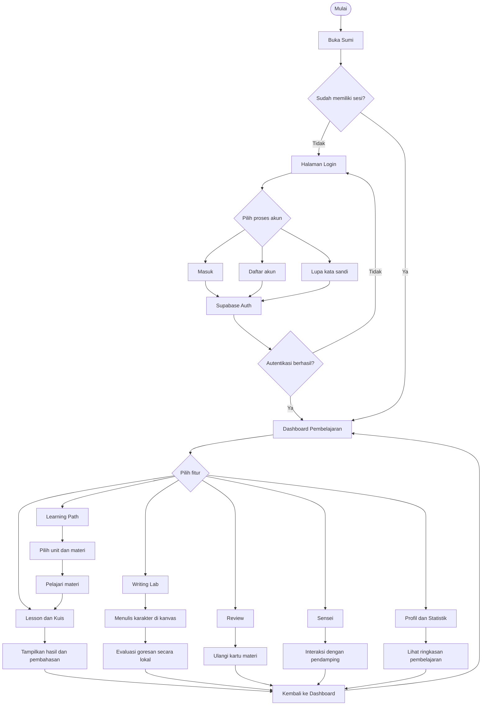
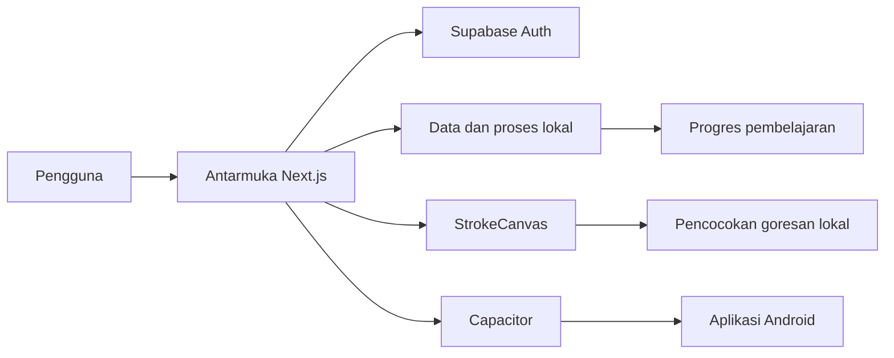

# Sumi · 墨

**Sumi** adalah platform pembelajaran bahasa Jepang untuk pemula yang berfokus pada persiapan JLPT N5–N4. Sumi menggabungkan materi huruf Jepang, kanji, kosakata, tata bahasa, latihan menulis, pengulangan berjeda, dan pengalaman belajar melalui aplikasi web maupun Android.

Antarmuka menggunakan bahasa Indonesia, sedangkan materi pembelajaran disajikan dalam bahasa Jepang. Sumi mengusung desain minimalis dengan inspirasi visual kertas hangat, tinta hitam, dan aksen vermilion.

> **Status proyek:** Fase 1 telah selesai. Landing page, design system, layar pratinjau pembelajaran, dan autentikasi Supabase telah tersedia. Beberapa integrasi lanjutan—termasuk pengisian progres otomatis, mesin SRS penuh, konten kurikulum, dan integrasi Gemini Live—masih merupakan pekerjaan fase berikutnya.

---

## Daftar Isi

- [Tentang Sumi](#tentang-sumi)
- [Latar Belakang Masalah](#latar-belakang-masalah)
- [Solusi yang Ditawarkan](#solusi-yang-ditawarkan)
- [Fitur dan Halaman](#fitur-dan-halaman)
- [Flowchart Sistem](#flowchart-sistem)
- [Tech Stack](#tech-stack)
- [Persyaratan Sistem](#persyaratan-sistem)
- [Langkah Instalasi](#langkah-instalasi)
- [Menjalankan Aplikasi Android dan Membuat APK](#menjalankan-aplikasi-android-dan-membuat-apk)
- [Dokumentasi Tampilan Aplikasi Android](#dokumentasi-tampilan-aplikasi-android)
- [Konfigurasi Supabase](#konfigurasi-supabase)
- [Struktur Proyek](#struktur-proyek)
- [Kredit](#kredit)

## Tentang Sumi

Sumi (墨) merupakan aplikasi pembelajaran bahasa Jepang yang dirancang untuk membantu pengguna mempelajari materi dasar secara bertahap. Materi utamanya mencakup:

- **Sistem tulisan:** Hiragana, Katakana, dan Kanji.
- **Kosakata:** pengenalan dan penguatan kosakata bahasa Jepang.
- **Tata bahasa:** pola kalimat dan penggunaan partikel.
- **Latihan menulis:** praktik menulis karakter Jepang menggunakan kanvas digital.
- **Pengulangan berjeda:** sesi review untuk membantu pengguna mengulang materi.
- **Pendamping belajar:** konsep Sensei berbasis suara/AI.

Sumi menyediakan antarmuka berbahasa Indonesia agar pengguna dapat memahami instruksi dan penjelasan materi dengan lebih mudah. Aplikasi juga dikembangkan menggunakan Capacitor agar pengalaman pembelajaran dapat diakses melalui perangkat Android.

## Latar Belakang Masalah

Mempelajari bahasa Jepang membutuhkan penguasaan beberapa komponen yang saling berkaitan, mulai dari mengenali Hiragana dan Katakana, memahami Kanji, menghafal kosakata, hingga menggunakan tata bahasa dalam kalimat. Bagi pembelajar pemula, banyaknya materi tersebut dapat membuat proses belajar terasa terpisah-pisah dan sulit dipantau perkembangannya.

Pembelajaran yang hanya berfokus pada membaca materi juga belum tentu memberikan kesempatan yang cukup untuk berlatih menulis karakter, menguji pemahaman, dan mengulang materi yang telah dipelajari. Tanpa pengelolaan progres dan pengulangan yang teratur, pengguna dapat kesulitan mengetahui materi yang sudah dikuasai maupun materi yang perlu dipelajari kembali.

Selain itu, sebagian pembelajar membutuhkan media yang mudah diakses melalui perangkat yang digunakan sehari-hari, termasuk telepon pintar. Kondisi tersebut menjadi dasar pengembangan Sumi sebagai platform pembelajaran bahasa Jepang yang menggabungkan materi, latihan, evaluasi, dan akses lintas platform dalam satu aplikasi.

## Solusi yang Ditawarkan

Sumi menyediakan pengalaman belajar terstruktur melalui beberapa pendekatan:

1. **Materi dalam satu platform** — mengelompokkan pembelajaran huruf, Kanji, kosakata, dan tata bahasa dalam unit pembelajaran.
2. **Latihan interaktif** — menyediakan latihan pilihan ganda beserta pembahasan untuk membantu pengguna mengevaluasi pemahaman.
3. **Praktik menulis digital** — menyediakan kanvas untuk menjiplak atau menulis karakter secara mandiri. Pencocokan goresan dilakukan secara lokal pada perangkat.
4. **Pengulangan materi** — menyediakan halaman review kartu dengan konsep spaced repetition untuk membantu pengguna mengulang materi.
5. **Pemantauan pembelajaran** — menampilkan ringkasan aktivitas, statistik, target harian, dan kebiasaan belajar pada area profil.
6. **Akses Android** — menggunakan Capacitor untuk membungkus aplikasi web menjadi aplikasi Android. Materi lokal dapat diakses tanpa koneksi internet setelah aplikasi tersedia di perangkat; fitur yang membutuhkan layanan Supabase tetap memerlukan koneksi.

## Fitur dan Halaman

| Halaman | Rute | Keterangan |
| --- | --- | --- |
| Landing page | `/` | Pengenalan platform, metode belajar, kurikulum, dan ajakan untuk mulai belajar. |
| Login | `/login` | Masuk, pendaftaran, verifikasi kode email, dan pemulihan kata sandi melalui Supabase Auth. |
| Dashboard | `/preview` | Ringkasan pembelajaran, unit, dan misi harian. |
| Learning | `/preview/learn` | Daftar unit pembelajaran tingkat N5. |
| Lesson | `/preview/lesson` | Latihan pilihan ganda dan pembahasan materi. |
| Writing Lab | `/preview/writing` | Latihan menulis karakter menggunakan kanvas digital. |
| Review | `/preview/review` | Antarmuka sesi pengulangan kartu dengan konsep FSRS. |
| Sensei | `/preview/sensei` | Antarmuka pendamping percakapan suara. Integrasi Gemini Live merupakan pengembangan lanjutan. |
| Profile | `/preview/profile` | Statistik pembelajaran, kebiasaan, dan lencana. |

**Catatan status:** beberapa halaman dan skema data telah tersedia, tetapi dokumentasi proyek menyebut pencatatan otomatis ke `login_events`, `lesson_progress`, dan `daily_activity` belum seluruhnya dihubungkan ke antarmuka. Fitur yang masih dalam tahap pratinjau tidak boleh dianggap sebagai layanan produksi yang sudah sepenuhnya aktif.

## Flowchart Sistem

Flowchart berikut menggambarkan alur umum pengguna dari membuka aplikasi, melakukan autentikasi, memilih fitur pembelajaran, hingga kembali ke dashboard.



### Gambaran Arsitektur Aplikasi



Kanvas menilai goresan menggunakan data acuan yang tersedia di aplikasi. Gambar tulisan pengguna tidak dikirim ke server untuk proses pencocokan tersebut.

## Tech Stack

| Teknologi | Peran |
| --- | --- |
| [Next.js 16](https://nextjs.org/) | Framework aplikasi web dengan App Router dan static export. |
| [React 19](https://react.dev/) | Pembangunan antarmuka berbasis komponen. |
| [TypeScript 5.9](https://www.typescriptlang.org/) | Sistem tipe untuk JavaScript. |
| [Tailwind CSS 4](https://tailwindcss.com/) | Styling dan design token antarmuka. |
| [Supabase](https://supabase.com/) | Autentikasi pengguna dan layanan database. |
| [Capacitor 8](https://capacitorjs.com/) | Integrasi aplikasi web ke platform Android. |
| [Motion](https://motion.dev/) | Animasi antarmuka. |
| [Perfect Freehand](https://github.com/steveruizok/perfect-freehand) | Pengolahan goresan pada kanvas tulisan. |
| [Lucide React](https://lucide.dev/) | Ikon antarmuka. |
| [KanjiVG](https://kanjivg.tagaini.net/) | Data acuan goresan Kanji. |
| [pnpm](https://pnpm.io/) | Package manager proyek. |
| [Gradle](https://gradle.org/) | Sistem build proyek Android. |

Versi dependensi rinci mengikuti `package.json` dan lockfile pada repository.

## Persyaratan Sistem

Untuk pengembangan web:

- Node.js versi yang kompatibel dengan Next.js 16.
- pnpm.
- Git.
- Akun dan proyek Supabase.

Untuk build Android:

- Android Studio.
- Android SDK dan Android SDK Platform Tools.
- JDK yang kompatibel dengan Gradle Wrapper proyek. **JDK 21 direkomendasikan untuk konfigurasi Gradle 8.14.3**; jangan gunakan JDK 25 dengan Gradle tersebut.
- Perangkat Android atau emulator untuk pengujian.

Periksa versi Java dan Gradle sebelum melakukan build:

```bash
java -version
cd android
./gradlew --version
```

Di Windows PowerShell, gunakan:

```powershell
java -version
cd android
.\gradlew.bat --version
```

## Langkah Instalasi

### 1. Clone Repository

```bash
git clone https://github.com/aazziiss-jpg/japanese-test.git
cd japanese-test
```

### 2. Instal Dependensi

```bash
pnpm install
```

### 3. Siapkan Environment Variable

Buat file `.env.local` pada root proyek:

```env
NEXT_PUBLIC_SUPABASE_URL=https://your-project.supabase.co
NEXT_PUBLIC_SUPABASE_PUBLISHABLE_KEY=your-supabase-publishable-key
```

Gunakan URL dan publishable key dari **Supabase Dashboard → Project Settings → API**. Jangan memasukkan `service_role` key ke variabel yang diawali `NEXT_PUBLIC_` atau ke kode frontend.

### 4. Konfigurasikan Supabase

1. Buat proyek melalui [Supabase Dashboard](https://supabase.com/dashboard).
2. Aktifkan provider Email pada menu Authentication → Providers.
3. Atur URL aplikasi dan Redirect URLs pada Authentication → URL Configuration.
4. Jika menggunakan verifikasi kode email, pastikan template email Supabase menyertakan `{{ .Token }}`.
5. Terapkan migrasi database yang tersedia pada `supabase/migrations/` melalui SQL Editor atau Supabase CLI.

Untuk menerapkan migrasi dengan Supabase CLI:

```bash
supabase link --project-ref YOUR_PROJECT_REF
supabase db push
```

### 5. Jalankan Aplikasi Web

```bash
pnpm dev
```

Buka alamat:

```text
http://localhost:3000
```

### 6. Periksa Kualitas dan Build

```bash
pnpm lint
pnpm build
```

Pastikan kedua perintah berjalan sesuai konfigurasi proyek sebelum melanjutkan ke build Android.

## Menjalankan Aplikasi Android dan Membuat APK

Sumi menggunakan Capacitor untuk mengemas hasil build web ke dalam proyek native Android.

### 1. Pastikan JDK dan Android SDK Tersedia

Pastikan `JAVA_HOME` menunjuk ke JDK yang kompatibel. Untuk Gradle Wrapper 8.14.3, gunakan JDK 21.

Contoh konfigurasi Windows:

```powershell
$env:JAVA_HOME = "C:\Program Files\Eclipse Adoptium\jdk-21"
$env:Path = "$env:JAVA_HOME\bin;$env:Path"

java -version
```

Sesuaikan lokasi JDK dengan direktori instalasi pada komputer.

### 2. Sinkronisasi Proyek Capacitor

Dari root proyek:

```bash
pnpm app:sync
```

Perintah ini membangun/menyiapkan aset web dan menyinkronkannya ke proyek Android sesuai script yang didefinisikan pada `package.json`.

### 3. Membuka Proyek Android Studio

```bash
pnpm app:open
```

Tunggu proses Gradle Sync selesai. Jika Android Studio meminta lokasi Gradle JDK, pilih JDK 21.

### 4. Membuat APK Debug

```bash
pnpm app:apk
```

Berdasarkan konfigurasi proyek, APK debug dihasilkan pada:

```text
android/app/build/outputs/apk/debug/app-debug.apk
```

### 5. Memasang APK ke Perangkat

Hubungkan perangkat Android dengan USB Debugging aktif, kemudian jalankan:

```bash
adb devices
adb install -r android/app/build/outputs/apk/debug/app-debug.apk
```

Untuk membuka aplikasi:

```bash
adb shell am start -n id.sumi.app/.MainActivity
```

> **Catatan:** perintah `app:sync`, `app:open`, dan `app:apk` harus tersedia pada bagian `scripts` di `package.json`. Jika nama script berubah, sesuaikan perintah dengan konfigurasi repository.

## Dokumentasi Tampilan Aplikasi Android

Bagian ini menampilkan dokumentasi antarmuka aplikasi Sumi
yang dijalankan pada perangkat Android.

### 1. Landing Page

<p align="center">
  
</p>

<p align="center"><em>Halaman utama yang memperkenalkan platform pembelajaran Sumi.</em></p>

### 2. Landing Page — Bagian Bawah

<p align="center">
  
</p>

<p align="center"><em>Bagian lanjutan landing page yang menampilkan informasi dan fitur pembelajaran.</em></p>

### 3. Login Page

<p align="center">
  
</p>

<p align="center"><em>Halaman autentikasi untuk masuk ke aplikasi Sumi.</em></p>

### 4. Register Page

<p align="center">
  
</p>

<p align="center"><em>Halaman pendaftaran akun pengguna baru.</em></p>

### 5. Lesson Page

<p align="center">
  
</p>

<p align="center"><em>Halaman penyajian materi pembelajaran bahasa Jepang.</em></p>

### 6. Japanese Letter Quiz

<p align="center">
  
</p>

<p align="center"><em>Halaman kuis untuk menguji pengenalan karakter Jepang.</em></p>

### 7. Japanese Letter Writing

<p align="center">
  
</p>

<p align="center"><em>Fitur latihan menulis karakter Jepang menggunakan kanvas digital.</em></p>

### 8. Conversation Test

<p align="center">
  
</p>

<p align="center"><em>Halaman pengujian kemampuan percakapan bahasa Jepang.</em></p>

### 9. Voice Test

<p align="center">
  
</p>

<p align="center"><em>Antarmuka pengujian interaksi berbasis suara.</em></p>

### 10. Chat AI

<p align="center">
  
</p>

<p align="center"><em>Antarmuka percakapan AI sebagai pendamping pembelajaran.</em></p>

### 11. Resume Lesson

<p align="center">
  
</p>

<p align="center"><em>Halaman untuk melanjutkan materi pembelajaran sebelumnya.</em></p>

## Konfigurasi Supabase

Autentikasi menggunakan Supabase Auth. Alur akun yang tersedia pada halaman `/login` meliputi:

- **Masuk:** email dan kata sandi.
- **Daftar:** email, kata sandi, dan konfirmasi kata sandi. Jika verifikasi email diaktifkan, pengguna memasukkan kode OTP.
- **Lupa kata sandi:** pengguna meminta kode pemulihan melalui email, kemudian menentukan kata sandi baru.

Skema database awal tersedia pada:

```text
supabase/migrations/20261104000000_init.sql
```

Tabel yang didefinisikan dalam migrasi:

| Tabel | Keterangan |
| --- | --- |
| `profiles` | Profil pembelajar, level, target harian, XP, dan streak. |
| `login_events` | Riwayat masuk dan keluar. |
| `units` dan `lessons` | Data unit dan materi kurikulum. |
| `lesson_progress` | Status, skor terbaik, dan jumlah percobaan pelajaran. |
| `srs_cards` dan `review_logs` | Data kartu pengulangan berjeda dan riwayat review. |
| `writing_attempts` | Riwayat latihan menulis dan akurasi. |
| `daily_activity` | Agregat aktivitas harian. |

Row Level Security (RLS) diterapkan pada tabel sesuai kebijakan migrasi. Data pengguna dibatasi berdasarkan kepemilikan akun. Periksa isi migrasi dan kebijakan Supabase sebelum menggunakan proyek pada lingkungan produksi.

## Struktur Proyek

```text
.
├── android/                 # Proyek native Android Capacitor
├── assets/                  # Aset ikon dan splash screen
├── docs/                    # Dokumentasi dan tangkapan layar aplikasi
├── src/
│   ├── app/                  # Rute Next.js App Router
│   ├── components/
│   │   ├── app/              # App shell dan native shell
│   │   ├── auth/             # Komponen autentikasi
│   │   ├── handwriting/      # Komponen kanvas tulisan
│   │   ├── marketing/        # Komponen landing page
│   │   ├── preview/          # Komponen halaman pembelajaran
│   │   └── ui/               # Komponen antarmuka umum
│   ├── content/              # Konten landing page
│   ├── data/                 # Data contoh pembelajaran
│   └── lib/
│       ├── handwriting/      # Data goresan dan pencocokan lokal
│       └── supabase/         # Konfigurasi klien Supabase
├── supabase/
│   └── migrations/           # Migrasi skema dan RLS
├── capacitor.config.ts       # Konfigurasi Capacitor
├── next.config.ts            # Konfigurasi Next.js
├── package.json              # Dependensi dan script proyek
└── README.md
```

## Kredit

- Data goresan Kanji menggunakan [KanjiVG](https://kanjivg.tagaini.net/) dengan lisensi CC BY-SA 3.0.
- Font antarmuka menggunakan Geist, Zen Kaku Gothic New, dan Shippori Mincho. Font Jepang di-host secara lokal agar tampilan tetap tersedia ketika aplikasi berjalan offline.

---

Dikembangkan sebagai proyek pembelajaran bahasa Jepang dengan nama **Sumi (墨)**.